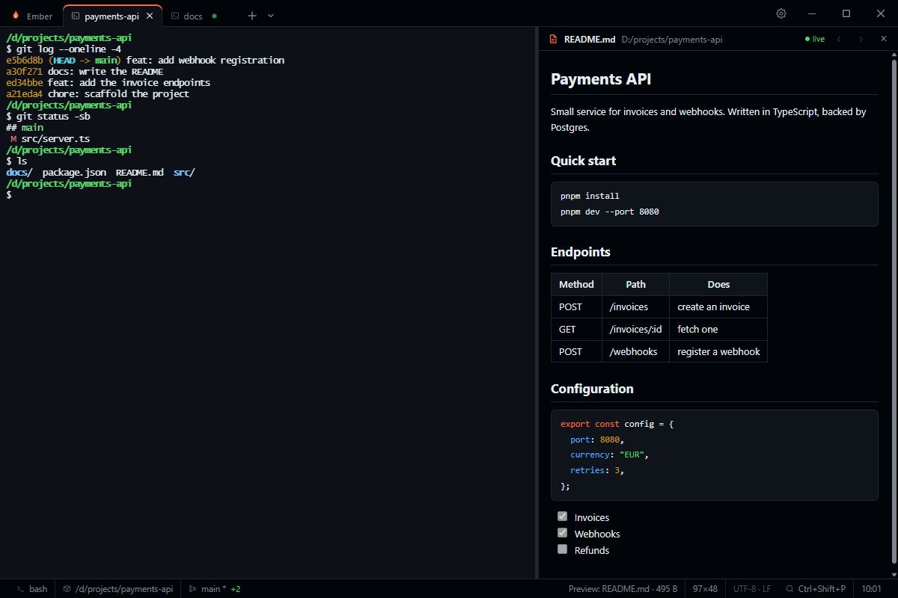

<h1 align="center">EmberTerm</h1>

<p align="center"><b>A light terminal for Windows and macOS that brings your tabs back.</b></p>

<p align="center">
  <a href="https://github.com/emberterm/emberterm/actions/workflows/ci.yml"></a>
  <a href="https://github.com/emberterm/emberterm/releases"></a>
  <a href="https://tauri.app"></a>
  <a href="LICENSE"></a>
</p>

EmberTerm opens fast, gives every tab its own shell, and puts everything back the way you left it:
tabs, splits, folders and your last commands. No account, no telemetry. It is built with Tauri 2
(Rust), Svelte 5 and xterm.js.



## Features

- **Session restore:** closing and reopening brings back every tab, split, title and folder, and each tab's last 10 commands (press Up)
- **A shell per tab:** Git Bash, WSL, PowerShell or cmd on Windows, your login shell on macOS; pick one from the arrow beside `+`, or set a default profile
- **Splits:** side by side or stacked, any shell in each pane
- **Markdown preview:** Ctrl+click a `.md` name in the output, or press Ctrl+Shift+M, to read the file rendered beside the terminal; it reloads when the file changes. A setting can open it after `cat README.md`
- **Tabs you can manage:** drag to reorder, Duplicate from the right-click menu, and a dot marks a tab that is running a command or has new output; closing a tab with a program running asks first
- **Copy, paste, find:** Ctrl+C (with a selection) / Ctrl+Shift+C, Ctrl+V, a right-click menu, Ctrl+Shift+F to search the scrollback, and Ctrl+click opens links
- **Stays fast under load:** WebGL rendering, and heavy output is batched so a flood does not freeze the window
- **Themes:** 7 built-in, or paste any VS Code theme JSON; the choice is remembered
- **Settings you would expect:** fixed-width font picker, font size, padding, cursor, scrollback, bell, keymap reference
- **Command palette:** Ctrl+Shift+P for tabs, profiles, splits, themes and the Markdown preview
- **Status bar:** shell, folder, git branch and changes, size, clock
- **Safe defaults:** programs cannot set your clipboard unless you allow it, and the app runs under a strict Content Security Policy
- **Window memory:** size, position and maximized state come back
- **Updates that ask first:** Settings → About → Check for updates shows what changed in every release since yours, and installs only when you click Install
- **Robust files:** config, profiles and `session.json` hot-reload; a broken file is moved aside with a toast and never blocks startup

## Why EmberTerm

Terminals that forget your tabs, or fail to start after an update, cost you time every day.
EmberTerm keeps one job: open fast, show your shells, and bring everything back the way you left it.
Settings, profiles and the session are plain files you can read, and a broken file never blocks startup.

## Folder and command restore

EmberTerm restores each tab's folder and last commands for Git Bash, WSL and PowerShell by injecting a
prompt hook. If your `~/.bashrc` *assigns* `PROMPT_COMMAND=...` or `PS0=...`, the hook is replaced.
Append instead:

    PROMPT_COMMAND="${PROMPT_COMMAND:+$PROMPT_COMMAND;}your_command"

The same hook tells EmberTerm when a command is running in Git Bash and WSL (needs bash 4.4+), which is
what makes "close this tab?" accurate there, and it is what lets the Markdown preview open after `cat`.
Commands that start with a space or look like they hold a secret (`token=`, `password:`) are not saved.
cmd does not restore its folder or commands.

## Install

Download the latest build from the [Releases](https://github.com/emberterm/emberterm/releases) page.
Builds are not code-signed, so the first launch asks you to confirm. After that, updates come from
inside the app.

- **Windows:** run the `-setup.exe` (or the `.msi`). If SmartScreen warns, choose *More info* → *Run anyway*.
- **macOS:** open the `.dmg` and drag EmberTerm to Applications. It is one app for Apple silicon and
  Intel. If macOS blocks the first launch, allow it in System Settings → Privacy & Security.

## Code signing policy

Windows installers are not code-signed yet, so SmartScreen may warn on first run. EmberTerm is applying for
free code signing provided by SignPath.io, certificate by SignPath Foundation. If the application is accepted,
this policy applies to the Windows installers:

- Free code signing provided by [SignPath.io](https://signpath.io), certificate by [SignPath Foundation](https://signpath.org).
- **Authors, reviewers and approvers:** the EmberTerm maintainers ([owners](https://github.com/orgs/emberterm/people?query=role%3Aowner)).
- **What is signed:** only installers built by the [Release workflow](.github/workflows/release.yml) from a version tag in this repository, and only after a maintainer approves the signing request for that release.
- **Privacy:** EmberTerm has no telemetry and sends nothing about you. Check for updates asks GitHub for the latest release and its notes (anonymous requests to `github.com` and `api.github.com`); links open only when you click them.

macOS builds are ad-hoc signed and not notarized, because notarization needs a paid Apple Developer Program
membership. See [#62](https://github.com/emberterm/emberterm/issues/62) for the signing plan.

## Development

Prerequisites: [Rust](https://rustup.rs/) 1.85+, [Node.js](https://nodejs.org/) 22+,
[pnpm](https://pnpm.io/) 9+, and WebView2 on Windows (preinstalled on Windows 11) or the Xcode
command line tools on macOS.

```sh
git clone https://github.com/emberterm/emberterm
cd emberterm
pnpm install
pnpm dev                 # desktop app with hot reload
```

```sh
pnpm turbo build                                          # frontend
cargo build --manifest-path packages/desktop/Cargo.toml   # app
cargo test --manifest-path packages/desktop/Cargo.toml    # Rust tests
pnpm turbo check test                                     # type-check + frontend tests
```

Installers are written to `target/release/bundle/`. See [CONTRIBUTING.md](CONTRIBUTING.md) for code
style, pull requests, versioning and releases.

## Project structure

```
packages/
  desktop/   Rust/Tauri core: PTY, shell hooks, config, profiles, session file, file preview, IPC
  app/       Svelte 5 UI: xterm.js, tabs, splits, Markdown preview, settings, themes (@emberterm/app)
  ui/        Shared Svelte components (@emberterm/ui)
scripts/     version.mjs (one version for the whole repo) and the release-notes builder
docs/        theming.md: writing and importing themes
```

[CLAUDE.md](CLAUDE.md) has the architecture, file map and IPC reference.

## Docs and contributing

[Contributing](CONTRIBUTING.md) · [Theming](docs/theming.md) · [Architecture](CLAUDE.md) · [Changelog](CHANGELOG.md) · [Security](SECURITY.md)

## License

[MIT](LICENSE)
